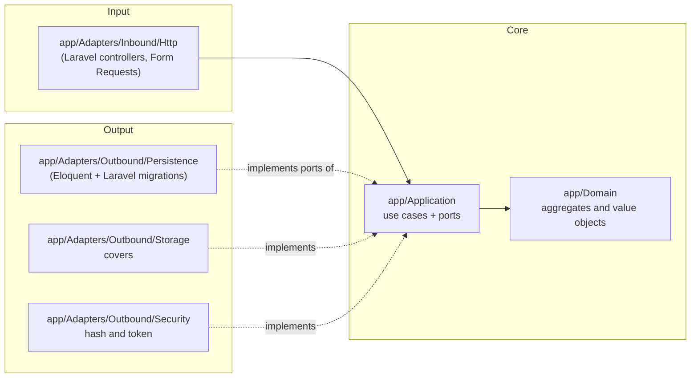
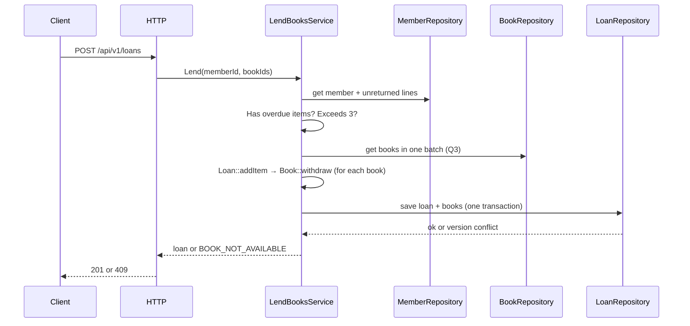

# Architecture — Manager Library (Laravel/React)

**Hexagonal** architecture (ports and adapters). The dependency rules are articles I to III of [`constitution.md`](constitution.md).

## 1. Layers and dependencies



Dependency arrows point **inward**. `app/Bootstrap` is the only place that sees both halves.

## 2. Folder structure

```text
app/
├── Domain/                      # Book, Loan, LoanItem, Member, User; Isbn, Quantity, DateRange
├── Application/
│   ├── Ports/Outbound/          # BookRepository, LoanRepository, MemberRepository, UserRepository,
│   │                            # ReportReader, Clock, PasswordHasher, TokenIssuer, CoverStorage
│   └── Services/                # LendBooksService, ReturnItemService, CreateBookService, SearchBooksService,
│                                # OverdueService, MostBorrowedReportService, LoginService, CreateLibrarianService
├── Adapters/
│   ├── Inbound/Http/            # controllers, form requests, auth middleware, error rendering
│   └── Outbound/                # Persistence/, Storage/, Security/
└── Bootstrap/Composition/PortBindings.php   # single composition point
```

Routes are declared in `routes/api.php` with the `/api/v1` prefix. Exception handling is configured in `bootstrap/app.php`.

## 3. Aggregates

| Root | Contains | Invariants it protects |
|---|---|---|
| `Book` | `Isbn`, total and available copies, soft delete | available between 0 and total; total ≥ 1; non-empty title |
| `Loan` | collection of `LoanItem` | 1 to 3 lines; no repeated book; due in 14 days; immutable except for return |
| `Member` | document | document required and unique |
| `User` | role, hash | normalized name; role in (`admin`, `librarian`) |

`Loan::addItem` calls `Book::withdraw` before adding the line: taking the copy and creating the line are **one single operation**.
`Loan::returnItem` calls `Book::restock` once per line.

## 4. Flow: register a loan



## 5. Errors

The domain and the application throw their own errors (`BookNotAvailable`, `MemberHasOverdue`, `MemberLimitExceeded`, …).
**Only** the HTTP adapter translates them into the single error body and the status code of
[`../spec-python/api-contract.md`](../spec-python/api-contract.md). The mapping is configured in Laravel's exception handling in
`bootstrap/app.php`, which delegates to the HTTP adapter. A framework error never reaches the client.

## 6. What there is not

No events, no queues, no cache, no microservices, no multi-tenancy. They are added if a requirement asks for them, not before.
